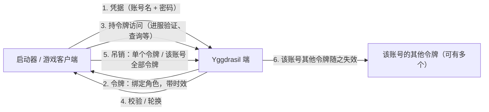
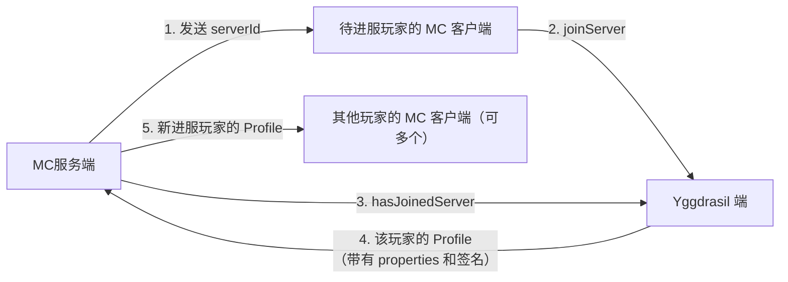
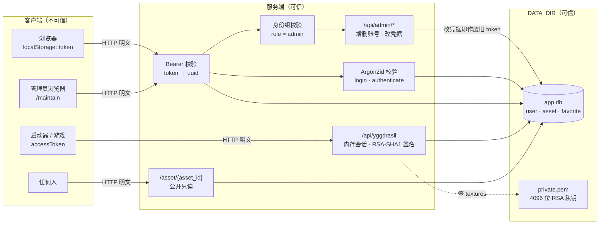

# 设计文档

- 本应用面向容器环境构建。
- 本应用定位上是轻量级的用于可信任的朋友间的私域 MC 皮肤与认证中心。
- 本应用被设计在为可信内网环境使用。
- 本应用不支持 `https`，如需公网部署，必须通过 `TLS` 反向代理以保证安全。
- 本应用用户管理由管理员身份组用户直接管理，不开放注册等相关内容。

## 1. 部署

### 1.1. 环境变量

| 变量            | 默认值                 | 用途                                                 |
| --------------- | ---------------------- | ---------------------------------------------------- |
| DATA_DIR        | `/data`                | 数据存储目录：`app.db` 与 `private.pem`              |
| TZ              | `Asia/Shanghai`        | 时区，用于日志时间戳                                 |
| HOST            | `127.0.0.1`            | 监听主机                                             |
| PORT            | `8080`                 | 监听端口                                             |
| ADMIN_USERNAME  | `admin`                | 首次启动生成的管理员账号名                           |
| ADMIN_PASSWORD  | 空（随机生成）         | 首次启动的管理员密码；留空则随机生成并打到启动日志里 |
| TRUSTED_PROXIES | `127.0.0.1/32,::1/128` | 可信反向代理网段，见 [5.5](#55-源-ip-与反向代理)     |
| READYZ_TOKEN    | 空（不校验）           | `/readyz` 的 `?token=` 门槛，见 [3.2](#32-readyz)    |

### 1.2. 首次启动

只做两件事：

1. 创建数据库和密钥，并部署内置资源
2. 生成一个管理员账号（`role = admin`）。账号表非空时不再动它。

不内置任何测试账号、不开放注册，账号由管理员在 `/maintain` 维护。

### 1.3. 日志

不落任何日志文件：访问日志、审计记录、错误都走 stdout 的结构化 JSON，由容器运行时收集。

日志一律英文（`msg`、错误串与字段值）：它面向运维与容器运行时；用户可见的文案才走 i18n，见 [2.4 语言](#24-语言)。业务校验错误（`core.ValidationError` / `core.ConflictError`）在日志里给的是**文案键与参数**（如 `initialize admin account: valid.password.short(8)`），渲染成哪种语言只发生在 HTTP 响应里。

访问日志只记页面与 `/api/*`：`/static/*`、`/asset/*` 与 `/livez` 不记（一次页面加载就是十几个静态请求；`/livez` 每 30 秒被存活探针敲一次且永远是 `200`），`/readyz` 照记 —— 它带 token 门槛，`401` / `503` 值得留痕。审计事件是另一回事，见 [5.4](#54-审计记录)。

### 1.4. 反向代理

公网部署必须套 TLS 反代，并且：

- 覆盖请求头 `Host`（`$host`）与 `X-Forwarded-Proto`（`$scheme`）—— 材质 URL 是拿它们拼的；
- `client_max_body_size` 不小于 `256k`（贴图上限 32 KiB；应用侧通用请求体上限 1 MiB）；
- 应用不做限流，`limit_req` / `limit_conn` 由反代承担，见 [5.3](#53-防爆破与加固措施)。

### 1.5. 文件权限

`DATA_DIR` 里的东西按「谁能读」分成两类，启动时统一收紧，`/readyz` 持续断言：

| 路径                           | 权限   | 理由                                   |
| ------------------------------ | ------ | -------------------------------------- |
| `DATA_DIR/`                    | `0700` | 只有属主能进                           |
| `app.db`（含 `-wal` / `-shm`） | `0600` | 里面有密码哈希与全部资源               |
| `private.pem`                  | `0600` | 签名私钥                               |
| `public.pem`                   | `0644` | 它本身就是公开信息（根元数据里会给出） |

启动时若无法收紧（如只读挂载）即启动失败；运行期被放开（如误 `chmod 644`）则 `/readyz` 变 `503`。**备份同样要按这个口径**：`app.db` 与 `private.pem` 属于机密，别放进公共目录。

## 2. 页面

### 2.1. /

主页，用于管理玩家的皮肤。

两处便利交互：PNG 文件可以直接拖到「上传新皮肤」按钮上，前端读 PNG 头的尺寸自己挑好类别再进上传面板（宽高相等 = 皮肤、宽是高的两倍 = 披风，`64×64` / `64×32` 之外的花样仍由后端预检报错）；搜索框旁的按钮弹出全部标签（按热度排序，同数按名称），点一下把标签并进搜索串。搜索本身是模糊匹配（见 [3.6](#36-api)）。

卡片的编辑入口复用同一套上传面板：把库里那条贴图的字节拉回来当作「刚选中的文件」，预检按内容命中同一条记录，于是改标签 / 模型走的就是「覆盖已有贴图」那条路；删除按钮只在编辑已入库的资源时出现在面板里，且仍然只给 `admin`（见 [5.1](#51-身份组)）。右侧 3D 面板的背面有三档：披风 / 鞘翅 / 隐藏 —— 鞘翅用的就是披风那张材质，与游戏内一致。3D 预览的光照自己定，不用 vendor 的默认值：贴图没有标 sRGB、合成器最后一道 FXAA 也不做输出编码，整条链路等效于「贴图原始字节 × 光照系数」（与 Minecraft 一样在显示空间乘光），所以环境光取 `0.6π`、主光 `0.46π`，正面系数≈0.96 与贴图本身一致；挂在相机上的点光源必须把 `decay` 归零 —— three 从 r155 起按 `1/d²` 衰减，默认 `decay=2` 时它离模型 50 多个世界单位、贡献约 1/2700，预览会退化成「六个面一样亮」。主光再挪到相机坐标系里的左上前方（约 40°），六个面才分得出明暗。交互：左键拖动旋转、滚轮缩放、**中键拖动平移**（vendor 默认 `enablePan=false`，且中键给的是 DOLLY，两处都改过）；平移有 20 个世界单位的软边界 —— 拦住时 target 与相机一起回移，只动 target 会把「相机到 target 的距离」改掉、看着像模型在缩小；「重置视角」连 `controls.target` 一起归零，否则就成了「站在原地看着别处」。

列表**窗口化虚拟滚动**（不分页）：卡片高度恒定（CSS 的 `--grid-row: 212px`，披风卡也是这个高度），于是「第几行」与「滚到哪」之间只是一次乘除法 —— spacer 撑出全量行数的高度、window 是绝对定位的渲染窗口，`translateY` 挪到该出现的位置，前后各多渲染 3 行；几百条时 DOM 里只有视口附近那几十张（实测 600 条 → 40 张）。行高与列数都从 DOM 现成的答案里读（`--grid-row`、浏览器按 `auto-fill` 算好的 `grid-template-columns`），不在 JS 里复刻布局规则。缩略图在卡片挂载时就画：窗口本身已经把数量限制住了，再套一层「滚到跟前才画」省不下多少，反而会在滚动视口底边上漏掉正好压线的那一行（用 `IntersectionObserver` 时实测滚过去 5 张空白卡）；卡片仍带 `content-visibility: auto`，屏外那几行不进渲染树。切换 tab / 类别 / 搜索会回到列表顶部；上传成功后要「滚到新卡片」时，store 只抛一个 `reveal` 请求，由视图层按行号换算滚动位置 —— 虚拟化之后那张卡片不一定在 DOM 里，不能再 `scrollIntoView`。网格以**标准卡片宽 123px 为下限**铺满列表区域：宽度富余时先让列适度增宽，够放下一张就加一列（列数不设上限），所以卡片永远不会掉到标准宽以下。卡片上最多放四个标签 chip，超出的显示 `+N`、鼠标悬浮时在浮动面板里补全。

### 2.2. /auth

登录界面。若用户未登录则跳转到此页面。

### 2.3. /maintain

管理员维护页面，仅管理员身份组可用，用于用户管理（创建 / 删除账号，改 UUID、账号名、密码、游戏内名称与身份组）。页面本身不做拦截，闸门在 `/api/admin/*`：非管理员打开只会看到一张「需要管理员身份」的提示卡。

### 2.4. 语言

界面文案与后端返回的文案都支持**简体中文**（`zh-Hans`，默认）与**英文**（`en`）两档。前端在每个请求上带 `Accept-Language` 头（值就是当前界面语言），后端按它挑文案、并在响应上回 `Content-Language`；选择存在浏览器本地，不跟账号走。Yggdrasil 那套错误文案是规范定死的英文，不翻译。

## 3. API

### 3.1. /

包含以下响应头 `X-Authlib-Injector-API-Location: /api/yggdrasil` 以让启动器自动发现与当前页面关联的 `yggdrasil` 服务。

### 3.2. /readyz

如果服务可用响应 `200 OK`，表示以下约定：

1. 通讯正常
2. 数据库可读写
3. 签名密钥已创建（`DATA_DIR/private.pem`，见 [1.5](#15-文件权限)）
4. `DATA_DIR` 与其中文件的权限已调整

不可用时回 `503`，无响应体，失败原因只进日志。

配了 `READYZ_TOKEN` 时必须带 `?token=<它>`：不带、带错都回 `401`，同样无响应体。它是个稳定的对外探测点，公网部署时值得加这道门槛；配了 token 之后 [1.4](#14-反向代理) 那种按来源 IP 的 allow-list 就可以省了。`/livez` 不受影响，永远是公开的存活探针。

### 3.3. /livez

只要服务在运行就统一响应 `200 OK`，无响应体。

[k8s.scoped-skin.yaml](k8s.scoped-skin.yaml) 用它做 `livenessProbe`（`initialDelaySeconds 5` / `periodSeconds 30` / `failureThreshold 3`）。**这条探针依赖镜像里的 `curl`**：podman 把 httpGet 翻成在容器内执行的 `curl -f http://localhost:8080/livez || exit 1`，镜像没装 curl 时探针恒失败，容器会被反复判 unhealthy 后重启（周期约 `initialDelay + failureThreshold × period` ≈ 93 秒），表现为日志里周期性出现 `server started` 而访问日志里一条 `/livez` 都没有。证据与取舍见 [5.7](#57-设计取舍)。

### 3.4. /asset/{asset_id}

内容寻址，返回指定的 asset 字节流。

带有长缓存响应头 `Cache-Control: max-age=31536000, immutable`。

### 3.5. /api/yggdrasil

详见：[Yggdrasil 技术规范](https://yushijinhun.github.io/authlib-injector/zh/Yggdrasil-%E6%9C%8D%E5%8A%A1%E7%AB%AF%E6%8A%80%E6%9C%AF%E8%A7%84%E8%8C%83.html)

| 方法 | 端点 | 说明            |
| ---- | ---- | --------------- |
| GET  | `/`  | 获取 API 元数据 |

**认证（auth）**:

令牌是本流程的中心：由凭据换取、绑定角色、带时效，只能由有效变为无效。具体端点与错误格式见下表。

| 方法 | 端点                       | 说明                           |
| ---- | -------------------------- | ------------------------------ |
| POST | `/authserver/authenticate` | 用于身份认证                   |
| POST | `/authserver/refresh`      | 吊销原令牌，并颁发一个新的令牌 |
| POST | `/authserver/validate`     | 检验令牌是否有效               |
| POST | `/authserver/invalidate`   | 吊销给定令牌                   |
| POST | `/authserver/signout`      | 吊销用户的所有令牌             |

**会话（session）**:

1. 服务端向待进服的玩家发送 serverId，其可以被视为一个随机的字符串。
2. 客户端将该 serverId 连同自己的 accessToken 发送给 Yggdrasil 端，请求验证。
3. 服务端将 serverId 及玩家的名字发送给 Yggdrasil 端，查询玩家是否已完成验证。
4. 若玩家验证成功，则 Yggdrasil 端将玩家的 Profile 返回给服务端，其中包含材质信息和数字签名。
5. 服务端将该玩家的 Profile 分发给服内所有玩家。

| 方法 | 端点                                                                                         | 说明                                              |
| ---- | -------------------------------------------------------------------------------------------- | ------------------------------------------------- |
| POST | `/sessionserver/session/minecraft/join`                                                      | 记录服务端发送给客户端的 serverId，以备服务端检查 |
| GET  | `/sessionserver/session/minecraft/hasJoined?username={username}&serverId={serverId}&ip={ip}` | 检查客户端会话的有效性                            |
| GET  | `/sessionserver/session/minecraft/profile/{uuid}?unsigned={unsigned}`                        | 查询指定角色的完整信息（包含角色属性）            |
| POST | `/api/profiles/minecraft`                                                                    | 按名称批量查询角色（不含角色属性）                |

- **token**：`accessToken` / `clientToken` 都是 32 位无横线 hex，会话只存在内存里（30 天过期，进程重启即失效；同一账号最多 8 个令牌，超出先吊销最旧的 —— 规范要求服务端限制令牌数，理由与代价见 [5.7](#57-设计取舍)）。
- **令牌状态**：新颁发的有效；被 `invalidate` / `signout` / `refresh` 顶掉的原令牌、以及过期令牌都无效（不可逆）。规范里可选的「暂时失效」未实现 —— 账号被改过（含改游戏内名称）时本站直接清掉它的全部令牌，客户端需要重新 `authenticate`。
- **角色绑定**：每个账号只有一个角色，`authenticate` 颁发的令牌始终已绑定，因此 `refresh` 携带 `selectedProfile` 一律回 `400 IllegalArgumentException`（规范中该操作要求原令牌未绑定角色）。
- **进服暗号**：`serverId` 由服务端下发，`hasJoined` 核对一次即作废，所以不能重复调用（防重放）；`join` 时记下客户端 IP，`hasJoined` 带了 `ip` 就比对，对不上也算不通过。
- **错误**：业务异常按规范返回 `403` + `{"error": "ForbiddenOperationException", "errorMessage": "..."}`（令牌无效 `Invalid token.`、凭据不对 `Invalid credentials. Invalid username or password.`）；一般 HTTP 异常的 `error` 取状态码的 Reason Phrase。
- **贴图**：`textures` 属性 = `base64(JSON)`，`SKIN.url` 指向 [3.4 /asset/{asset_id}](#34-assetasset_id)（内容寻址、公开只读，客户端直接拉）；`kind` 映射到 `metadata.model`：`skin.steve` → `default`（正常手臂宽度）、`skin.alex` → `slim`（细手臂），`cape` 本就不是皮肤、不带 metadata；`unsigned=false` 时用 **RSA-SHA1** 对 base64 串签名，公钥即根元数据里的 `signaturePublickey`，私钥落在 `DATA_DIR/private.pem`（首次启动生成 4096 位）。
- **与站点登录的关系**：两套 token 互不相通 —— 站点 token 是 HMAC（密钥每次启动随机，重启即全部失效）；Yggdrasil 的 `accessToken` 是随机数、也只活在内存里。管理员在 `/maintain` 动过某个账号（删号 / 改 UUID / 改凭据）时，会按 uuid 把这个账号的 Yggdrasil 会话一并清掉。
- **防爆破**：应用侧不做限流；`authenticate` / `signout` 依靠恒定请求时间 —— 无论账号存不存在，每次请求都至少消耗 1 秒才返回（[5.3 防爆破与加固措施](#53-防爆破与加固措施)），单个客户端的串行请求频率因此不超过 60 次/分钟。更严格的频率上限由反向代理承担（[1.4](#14-反向代理)）。
- **profile 与签名细节**：`authenticate` 带 `requestUser=true` 时响应另含 `user`；profile 的 `id` 为无横线 UUID，接口亦接受带横线写法，角色不存在回 `204` 而非 `403`；`unsigned` 默认 `true`（不带签名），仅显式 `unsigned=false` 时签名。textures 属性为 `base64(JSON)`，含 `timestamp`（Java 毫秒）、`profileId`、`profileName`；签名算法为 RSA-SHA1 + PKCS1v15，密钥对落在 `DATA_DIR/private.pem`（PKCS#8）与 `public.pem`（PKIX），首次启动以标准库 `crypto/rsa` 生成 4096 位后复用
- **材质 URL 与 skinDomains**：材质 URL 以请求的 `Host` 拼接绝对地址，`X-Forwarded-Proto: https` 时用 https；`skinDomains` 白名单为请求所用域名加 `127.0.0.1` 与 `localhost`
- **`hasJoined` 的 IP 核对**：`ip` 不一致时返回 `204` **且不消费暗号**（避免一个抄错 IP 的查询把玩家挡在门外）。经反代或 NAT 时两端观察到的 IP 可能不同，此情形下不应开启 MC 服务端的 `prevent-proxy-connections`
- **发现机制**：`GET /` 带响应头 `X-Authlib-Injector-API-Location: /api/yggdrasil`，把站点地址交给启动器即可自动定位服务

### 3.6. /api/*

除上述定义以外的其他 API 端口，通常服务于特定的应用功能，无需详细了解。除 `login` 外，都需要 `Authorization: Bearer <token>`，否则 `401`；其中 `/api/admin/*` 还要求 `role = admin`，否则 `403`。

返回里所有用户可见的文案（错误 `detail`）按请求的 `Accept-Language` 本地化（见 [2.4 语言](#24-语言)）。

| 方法   | 路径                             | 鉴权         | 描述                                                              |
| ------ | -------------------------------- | ------------ | ----------------------------------------------------------------- |
| POST   | `/api/auth/login`                | 公开         | 账号密码换 token                                                  |
| GET    | `/api/auth/session`              | Bearer       | 校验 token 是否有效，返回当前账号                                 |
| GET    | `/api/tags`                      | Bearer       | 库里已有标签 + 使用次数                                           |
| GET    | `/api/library`                   | Bearer       | 列表（`category` / `tab` / `q`）+ 统计                            |
| POST   | `/api/precheck`                  | Bearer       | 上传前预检：请求体 `{kind, data}`（`data` 是原图 base64），服务端校验并算 `asset_id` |
| POST   | `/api/skins`                     | Bearer       | 上传贴图（multipart：`file` / `kind` / `tags`），或覆盖已有贴图的标签与 kind |
| POST   | `/api/items/{asset_id}/favorite` | Bearer       | 切换收藏                                                          |
| DELETE | `/api/items/{asset_id}`          | Bearer       | 删除贴图（只读资源不可删）                                        |
| GET    | `/api/me`                        | Bearer       | 当前账号 + 装备中的皮肤 / 披风                                    |
| POST   | `/api/me/equip`                  | Bearer       | 装备某个贴图                                                      |
| GET    | `/api/admin/users`               | Bearer admin | 账号列表                                                          |
| POST   | `/api/admin/users`               | Bearer admin | 创建账号                                                          |
| PATCH  | `/api/admin/users/{uuid}`        | Bearer admin | 改 UUID / 账号名 / 密码 / 游戏内名称 / 身份组                     |
| DELETE | `/api/admin/users/{uuid}`        | Bearer admin | 删除账号                                                          |

贴图条目（asset）的统一字段：`id`（= 规范化后字节的 sha256，见 [4.2 表：asset](#42-表asset)）、`kind`（`skin.steve` / `skin.alex` / `cape`，模型已并进这一列）、`category`（由 `kind` 推出的粗分类 `skin` / `cape`，列表筛选与前端分类用它）、`tags`、`upload_at`、`readonly`、`width`、`height`、`size`、`favorite`、`texture_url`（= `/asset/{id}`）。

列表的 `q` 是模糊搜索：按空白切成多个查询词，每个词都要**子串命中**条目的某个标签（大小写不敏感，取交集）。排序先看命中档位 —— 前缀 → 中缀 → 后缀；一个词命中多个标签取最好那档，多个查询词取最差那档，同档才按上传时间倒序。

写接口的身份组要求：`/api/skins` 要 `admin` / `normal`，`/api/items/{asset_id}/favorite` 与 `/api/me/equip` 同样要 `admin` / `normal`（`guest` 只读，见 [5.1](#51-身份组)），`DELETE /api/items/{asset_id}` 与 `/api/admin/*` 要 `admin`。

### 3.7. /static/*

分发前端静态资源（HTML 之外的 js / css / vendor）。只认具体文件：目录与不存在的路径一律 `404`，不提供目录列表。

## 4. 数据库

本项目采用单个 SQLite 数据库存储所有数据，无外键约束设计，业务逻辑由代码保证。

### 4.1. 表：user

| 字段            | 类型    | 约束       | 说明                                                  |
| --------------- | ------- | ---------- | ----------------------------------------------------- |
| `id`            | INTEGER | 自增主键   | 业务无关主键                                          |
| `uuid`          | TEXT    | 唯一，非空 | 用户 UUID，定长 32 位小写字母 + 数字组合              |
| `role`          | TEXT    | 非空       | 用于身份组，枚举量：admin / normal / guest            |
| `player_name`   | TEXT    | 唯一，非空 | 游戏内角色名，最大长度 16，仅允许小写字母+下划线+数字 |
| `username`      | TEXT    | 唯一，非空 | 账号登录名                                            |
| `password_hash` | TEXT    | 唯一，非空 | 账号登录密码                                          |
| `skin`          | TEXT    | 非空       | 装备的皮肤，空串表示未装备                            |
| `cape`          | TEXT    | 非空       | 装备的披风，空串表示未装备                            |

- `password_hash` 使用 Argon2id 算法进行哈希，默认取 `m=19456 (19 MiB), t=2, p=1`（PHC 串：`$argon2id$v=19$m=…,t=…,p=…$<salt>$<hash>`，salt 与摘要为无填充 base64）
- 密码长度 8 ~ 256 个字符（下限只起提醒作用）

### 4.2. 表：asset

| 字段        | 类型    | 约束       | 说明                                   |
| ----------- | ------- | ---------- | -------------------------------------- |
| `id`        | INTEGER | 自增主键   | 业务无关主键                           |
| `asset_id`  | TEXT    | 唯一，非空 | 资源 ID，见下方说明                    |
| `kind`      | TEXT    | 非空       | 枚举串：skin.steve / skin.alex / cape  |
| `readonly`  | INTEGER | 非空       | 指示资源是否为只读资源（用户无法编辑） |
| `upload_at` | INTEGER | 非空       | 资源上传时间，采用 UNIX 秒级时间戳     |
| `tags`      | TEXT    | 非空       | 资源的标签，使用 json 字符串列表存储   |
| `data`      | BLOB    | 非空       | 资源文件的二进制数据                   |

- 除 `favorite` 的唯一索引外不额外建索引：库小，列表查询本来就要全表扫一遍再按 `upload_at` 排序，按 `kind` 建索引收益有限，反而带来写放大
- `tags` 最多 8 个，单条最长 32 字符（见 [5.2 校验边界](#52-校验边界)）
- `asset_id` 与 `data` 的关系：上传/内置的 PNG 先**解码再重新编码**（去掉 PNG 中与位图无关的 chunk），重新编码后的字节才是 `data`；`asset_id` = 这串字节的 sha256。所以它不再是「上传文件本身的 sha256」——同一个角色像素、不同元数据的两个文件会落到同一条资源上，客户端也不该自己算这个 ID（预检会把它回给前端）。
- 库内预置 9 个官方默认皮肤（Ari / Kai / Steve / Sunny / Zuri 取 wide = `skin.steve`，Alex / Efe / Makena / Noor 取 slim = `skin.alex`），`readonly = 1`：不可删除（接口 `400`），但可收藏、装备与搜索；启动时按 manifest 对齐（缺者补入、多余变体删除），用户数据不受影响
- 内置资源的 `upload_at` 使用固定基准时间，因此始终排在用户上传之后
- 列表里的 `width` / `height` 不占列：查询时只取 BLOB 前 24 字节（PNG IHDR）现算，省掉两列与它们的同步问题

### 4.3. 表：favorite

| 字段     | 类型    | 约束     | 说明         |
| -------- | ------- | -------- | ------------ |
| `id`     | INTEGER | 自增主键 | 业务无关主键 |
| `player` | TEXT    | 非空     | 用户 UUID    |
| `asset`  | TEXT    | 非空     | 皮肤 Id      |

- 唯一索引：`(player, asset)`
- 修改 `user.uuid` 时一并更新 `favorite.player` 中指向旧 uuid 的行（无外键，由代码保证）

## 5. 安全模型

信任边界如下图：客户端一律不可信，服务端进程与 `DATA_DIR` 可信，TLS 由反向代理终结（见 [1.4](#14-反向代理)）。

- **传输**：应用只提供明文 HTTP（无 TLS、无 CORS 配置），TLS 由反向代理终结；Yggdrasil 接口面向启动器与服务端，不支持浏览器跨域调用。
- **可信**：服务端进程、`DATA_DIR`（库与密钥）、反向代理（终结 TLS，并覆盖 `Host` 与 `X-Forwarded-Proto`）。
- **不可信**：浏览器、启动器与游戏客户端，以及任何请求 —— 包括 `/api/yggdrasil/*`。
- **防御目标**：越权访问（Bearer 与身份组）、凭据失窃后的横向移动（恒定耗时、不暴露账号是否存在）、资源耗尽（各类上限与闸门）、传输与缓存篡改（TLS 与 textures 签名）、事后追溯（审计记录）。
- **非目标**：不防御已能读取 `DATA_DIR` 的攻击者（库与私钥明文落盘）；不做内容审核；不提供注册、自助改密、找回、2FA 与会话管理界面 —— 逐条取舍的理由与代价见 [5.7](#57-设计取舍)。

### 5.1. 身份组

| 身份   | 浏览 / 预览 | 收藏 | 更换皮肤与披风 | 上传贴图 | 删除贴图 | 管理用户 |
| ------ | ----------- | ---- | -------------- | -------- | -------- | -------- |
| guest  | ✅️          |      |                |          |          |          |
| normal | ✅️          | ✅️   | ✅️             | ✅️       |          |          |
| admin  | ✅️          | ✅️   | ✅️             | ✅️       | ✅️       | ✅️       |

`guest` 是**只读身份组**：不允许修改任何持久化资源 —— 收藏、更换装备、上传、删除都要求 `admin` / `normal`（闸门是 `currentWriter` / `currentAdmin`，回 `403` + `auth.write` / `auth.admin`）；读接口（列表、标签、`/api/me`、预检、`/asset/*`）不受限。

`role` 每次请求现查库，改动立即生效：已发出的 token 不因此作废，但下一次请求即被 `403` 挡下。最后一个管理员不可删除、不可降级。

### 5.2. 校验边界

- 请求体上限 1 MiB：Content-Length 预校验 + `MaxBytesReader` 兜底，分块读达到上限直接返回 400；
- `kind` 只接受 `skin.steve` / `skin.alex` / `cape`，模型已并进这一列（没有「自动判断」这一档，由前端判定后显式提交）；
- 贴图入库前只校验 PNG 头、尺寸与能否解码，不做内容审核；入库前**解码后重新编码**（剥掉 PNG 里与位图无关的 chunk），`asset_id` 取的就是这串入库字节的 sha256；

| 资源类型 | 要求                      | 体积上限 |
| -------- | ------------------------- | -------- |
| 角色皮肤 | `64 × 64`（宽 64、高 64） | `32 KiB` |
| 角色披风 | `64 × 32`（宽 64、高 32） | `32 KiB` |

- 只接受默认尺寸，HD 贴图一律拒绝；
- 标签最多 `8` 个，单条最长 `32` 字符；
- 删除操作仅限 admin 组用户。

### 5.3. 防爆破与加固措施

- **恒定请求时间**：无论账号存在与否、密码对错，账号验证都至少等待 1 秒才返回，用来抹掉「不存在的账号秒回」这个时序侧信道，也顺带把单客户端的请求频率压到 60 次/分钟以下；
- **Argon2id 并发上限**：同时进行的校验最多 4 个（`app.ArgonConcurrency`）。每次校验要吃 19 MiB，不限并发即等于放弃内存上限（实测 30 并发会把常驻内存从 18 MiB 抬到 513 MiB）；
- **请求并发上限**：`/api/*` 共用 `128` 个槽位（`api.MaxConcurrentRequests`），超出的在闸门外排队（客户端断开即直接放行），避免 goroutine / SQLite / Argon2 同时被放开；页面、`/static/*` 与 `/asset/*` 不占槽位 —— 它们不吃 Argon2，没必要跟着受限；
- **安全响应头**：所有响应都带 `X-Content-Type-Options: nosniff`、`Referrer-Policy: no-referrer`、`X-Frame-Options: DENY`。CSP 暂不引入（前端用 Vue 全局构建，模板在运行时编译，需要 `unsafe-eval`，见 [5.7](#57-设计取舍)）；
- **频率上限**：应用侧不做限流，由反向代理承担 —— 站点登录建议 `5r/m`，上传与 `authenticate` 建议 `30r/m`，并配 `limit_conn`；应用自身只保证「同时在处理的 `/api/*` 请求 ≤ 128」。

### 5.4. 审计记录

审计记录和其它日志一样流向 stdout，不落文件；每条都带远程 IP 与时间戳（RFC 3339，时区取 `TZ`）。

| event          | 额外字段                                                                                      |
| -------------- | --------------------------------------------------------------------------------------------- |
| `login`        | `username`、`result`（`ok` / `denied`），成功时另有 `uuid`                                    |
| `user.create`  | `actor`（操作者 uuid）、`uuid`、`username`、`player_name`、`role`                             |
| `user.update`  | `actor`、`uuid`、`was_uuid`、`username`、`changed`（改动字段名，不含密码本身）                |
| `user.delete`  | `actor`、`uuid`、`username`                                                                   |
| `asset.upload` | `actor`、`asset_id`、`kind`、`size`、`result`（`created` / `updated` / `unchanged`） |
| `asset.delete` | `actor`、`asset_id`                                                                           |

### 5.5. 源 IP 与反向代理

客户端 IP 只在**连接的对端落在 `TRUSTED_PROXIES` 网段里**时才认反代头，否则一律取对端地址 —— 以免服务被直接访问时伪造 `X-Forwarded-For` 冒充他人。取值时自 `X-Forwarded-For` 的**最右**往左走，跳过可信网段里的每一跳，第一个不可信地址就是真正的客户端（反代追加在右边的那一跳伪造不了）；没有 `XFF` 时退回 `X-Real-IP`。

反向代理侧必须覆盖 `Host` 与 `X-Forwarded-Proto`：Yggdrasil 的材质 URL 由它们拼接，不覆盖即等同于让请求方决定签名中的域名。

### 5.6. 会话与凭据

两套凭据互不相通，且都只存在于内存：

| 凭据                    | 形态                                                                                                               | 生命周期                   | 失效方式                                                                                                                |
| ----------------------- | ------------------------------------------------------------------------------------------------------------------ | -------------------------- | ----------------------------------------------------------------------------------------------------------------------- |
| 站点 token              | `HMAC-SHA256(进程密钥, uuid + \x1F + 账号名 + \x1F + password_hash)`（`\x1F` 为 ASCII 单元分隔符；[3.6](#36-api)） | 不过期；进程重启即全部失效 | 改该账号的 uuid / 账号名 / 密码，或重启服务                                                                             |
| Yggdrasil `accessToken` | 随机 32 位无横线 hex（[3.5](#35-apiyggdrasil)）                                                                    | 30 天；进程重启即全部失效  | `invalidate`（单个）、`signout`（该账号全部）、`refresh`（被轮换的那个）、改动账号、同账号超过 8 个令牌时最旧的先被顶掉 |

- **口令**：库中只保存 Argon2id 哈希（默认 `m=19456, t=2, p=1`）；失败一律「用户名或密码不正确」，不暴露账号是否存在。
- **凭据变更即失效**：管理员改动某账号的 uuid / 账号名 / 密码后，该账号的站点 token 立即失效（内存 token 表按库中字段整表重算，同一进程内未被改动者不变）；其 Yggdrasil 会话一并清除，`/authserver/validate` 随即返回 `403`。删号与改 UUID 按 UUID 清，本次被改过的账号直接清。
- **站点 token 的存放**：前端置于 `localStorage` 并放在 `Authorization` 头中 —— 不涉及 cookie，因而没有 CSRF 面；代价是 XSS 即等同于交出账号。
- **贴图公开**：`/asset/{asset_id}` 不鉴权（`` 无法附带自定义头，且 URL 本身即内容哈希）；这是皮肤系统能工作的前提，不属于遗漏。

### 5.7. 设计取舍

| 取舍                                          | 理由                                                                                        | 代价                                                                          |
| --------------------------------------------- | ------------------------------------------------------------------------------------------- | ----------------------------------------------------------------------------- |
| 应用侧不做限流，改用恒定请求时间              | 免去按 IP / 按用户的共享状态；恒定 1 秒同时抹掉时序侧信道                                   | 只约束串行请求（60 次/分钟），并发下的频率上限必须由反代 `limit_req` 承担     |
| 站点 token 采用进程随机密钥的 HMAC            | 库文件（uuid / 账号名 / password_hash）本身不足以推出 token                                 | 重启即全体掉线；无法单条吊销                                                  |
| 站点 token 不落库、不过期                     | 省去会话表、清理与续期逻辑                                                                  | 泄漏后只能靠改密码或重启收回                                                  |
| 首次启动只建一个管理员，不开放注册            | 私域使用，注册与邮箱校验的成本高于收益                                                      | 新增账号必须由管理员操作                                                      |
| 不提供自助改密、找回与 2FA                    | 账号唯一入口是管理员，与上一条同源                                                          | 忘记密码只能由管理员重置                                                      |
| 贴图内容寻址（入库字节的 sha256）并强制重编码 | 天然去重、ID 稳定；重编码同时满足规范「除去与位图无关数据」的要求                           | 前端无法自算 ID，故需 `/api/precheck`；像素相同而元数据不同的文件会合并为一条 |
| 只收默认尺寸，上限 32 KiB                     | 规范警告的 PNG 炸弹与时序问题在源头消失；满熵 `64×64` RGBA 约 16.5 KiB，32 KiB 留一倍余量   | 不接受 HD 贴图                                                                |
| 贴图无归属字段                                | 库为全员共享，模型最简                                                                      | 删号不删图，无法实现「我的上传」                                              |
| textures 沿用 RSA-SHA1                        | 规范将算法固定为 SHA1withRSA 且客户端硬编码验签；公钥取自同一元数据，签名仅防传输与缓存篡改 | 该算法在现代标准下已弃用                                                      |
| 标签代替命名，且无固定词表                    | 免去分类体系与命名冲突                                                                      | 无重命名 / 合并功能，搜索只有子串匹配（不认拼音、拼写错误与词形）             |
| SQLite 单文件、单连接、无外键                 | 便于单文件部署与备份，且可 `CGO_ENABLED=0` 产出静态二进制                                   | 一致性由代码保证（删资源需手工清理 favorite 与装备）                          |
| 前端用 Vue 全局构建、模板运行时编译           | 无 npm 与打包器，改完重新编译即可                                                           | 无法使用严格 CSP（需 `unsafe-eval`）                                          |
| 日志不落文件、审计走 stdout                   | 由容器运行时统一轮转与收集                                                                  | 无内置查看入口                                                                |
| 贴图管理自建，未实现规范的材质上传接口        | 上传流程需与本站的预检、标签、收藏联动                                                      | 角色属性不返回 `uploadableTextures`，第三方客户端无法直接修改材质             |
| 每账号最多 8 个令牌，超出先吊销最旧的         | 规范要求服务端限制令牌数；内存表不能随登录次数无界增长                                      | 同一账号开第 9 个客户端时最早那个被静默登出，得重新 `authenticate`            |
| 存活探针靠镜像里的 `curl` 执行                | podman 把 kube 的 httpGet 翻成在容器内执行的 `curl -f <url>`（失败即退出），装 curl 才能用 k8s 式探针 | 镜像多几个 MB 依赖；漏装即退化成每约 93 秒一次的重启循环（见 [3.3](#33-livez)） |
