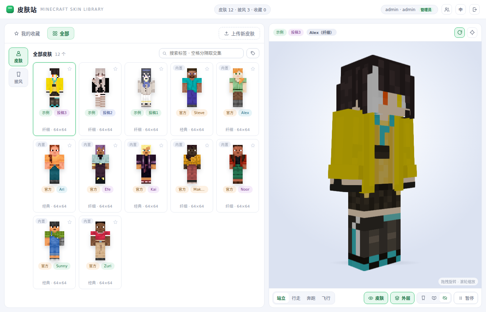
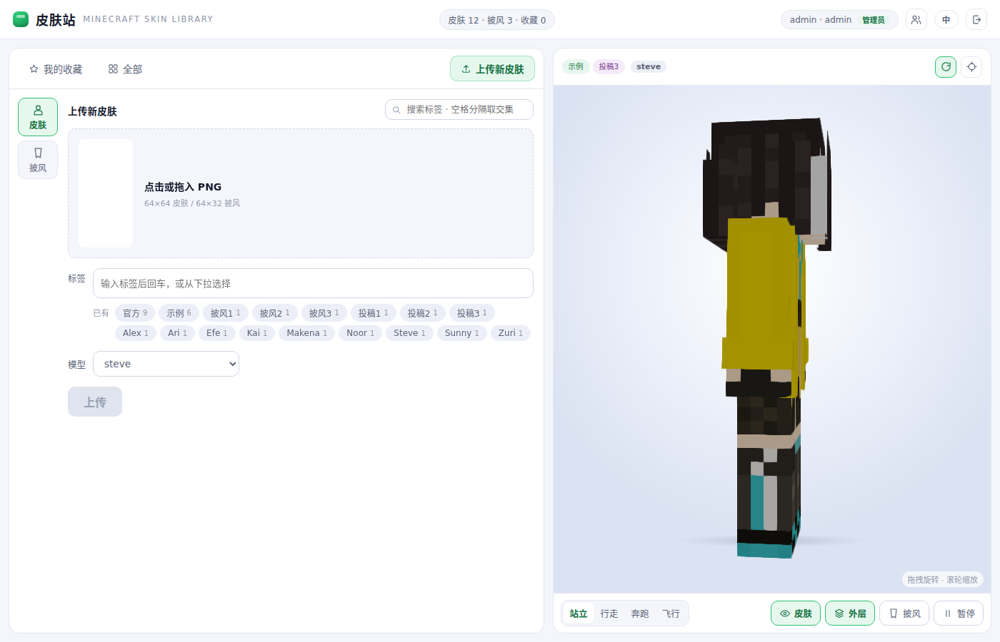
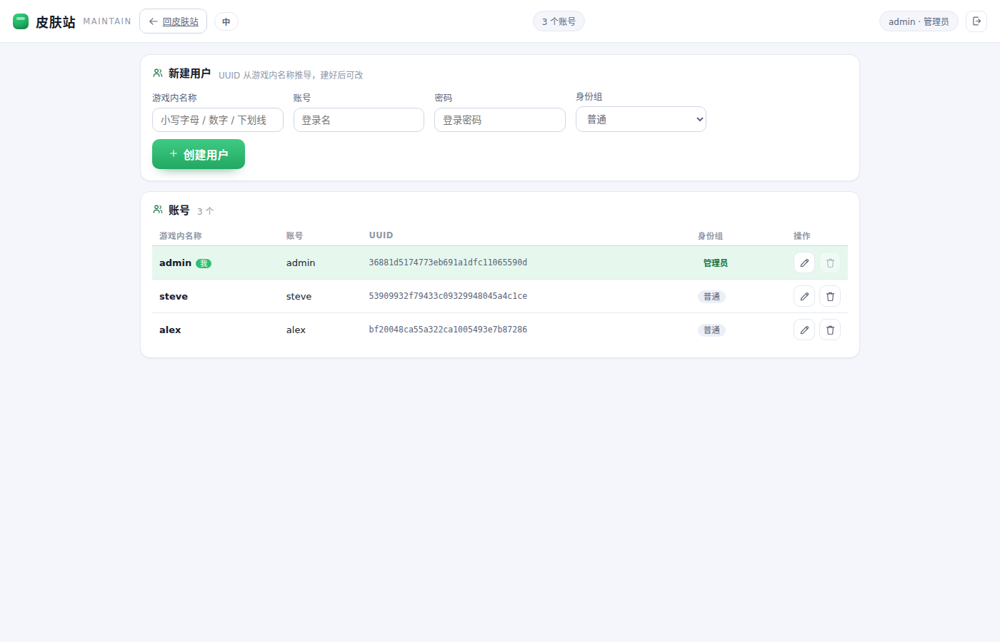
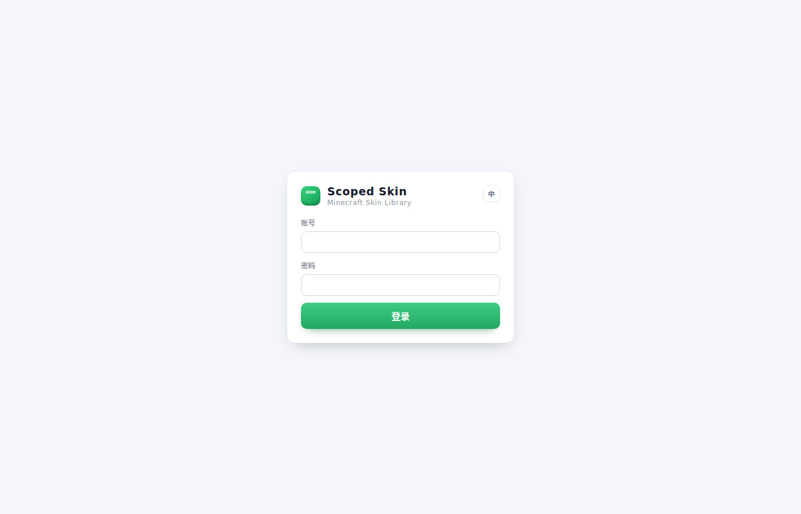
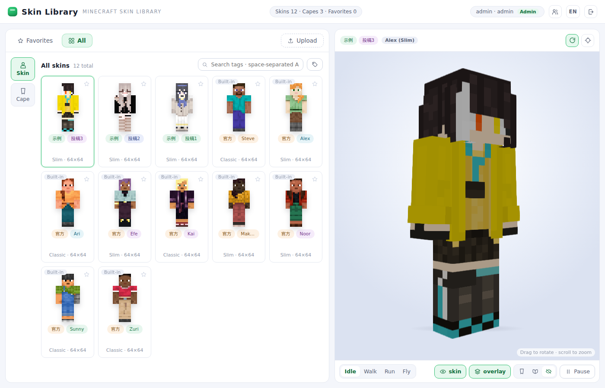

# scoped-skin · 私域 Minecraft 皮肤站

`scoped-skin` 是一个 Go 实现的 Minecraft 皮肤站（标准库 `net/http` + `modernc.org/sqlite`）：单页提供贴图的浏览 / 收藏 / 上传与实时 3D 预览，并实现 Yggdrasil（authlib-injector 兼容）认证。前后端经 `go:embed` 编入同一静态二进制，运行时不依赖外部文件；界面与接口文案支持简体中文与英文。

3D 预览使用 [skinview3d](https://github.com/bs-community/skinview3d)（UMD bundle，`<script>` 引入），界面基于 [Vue 3](https://vuejs.org/) 全局构建：状态集中于 `js/store.js`，视图为 `js/components/*`，模板在运行时编译，无构建步骤；两个库均置于 `web/vendor/`，运行时不请求外部 CDN。布局参考 [Blessing Skin Server](https://github.com/bs-community/blessing-skin-server)。




## 页面

三个页面：`/` 皮肤库、`/auth` 登录、`/maintain` 管理员维护（不开放注册；非管理员只会看到「需要管理员身份」；最后一个管理员不可删除或降级）。

`guest` 是只读身份组：不能上传、收藏或换装（见 [DESIGN.md 5.1](DESIGN.md#51-身份组)）。







## 快速开始

```bash
make run                                   # DATA_DIR=./data，首次启动建号：admin / devpass123
# 打开 http://127.0.0.1:8080，未登录会跳转 /auth
make run ADMIN_PASSWORD='别的密码'          # 覆盖开发密码（仅首次建号时生效）
make build                                 # 或编译单文件二进制：./scoped-skin
```

> 容器：`docker build -t scoped-skin .` 直接产出镜像（构建阶段 `CGO_ENABLED=0`，运行阶段为 alpine + tzdata；`/data` 为 `VOLUME`，镜像内已设 `HOST=0.0.0.0` 与 `PORT=8080`）。

`make run` 等价于 `DATA_DIR=./data ADMIN_PASSWORD=devpass123 go run .`。生产不设 `ADMIN_PASSWORD`：首次启动会随机生成管理员密码，并把明文写进启动日志（仅此一次）：

```json
{"level":"WARN","msg":"first start: generated admin account","username":"admin","password":"…"}
```

首次启动只做两件事：灌入内置资源、建一个管理员账号；**账号表非空时启动不再改动它**（改过的密码与账号名原样保留）。清空重来即删除整个 `DATA_DIR` 再启动。全部环境变量见 [DESIGN.md 1.1](DESIGN.md#11-环境变量)。

## 测试

```bash
make test        # go test ./... -count=1
make vet         # go vet ./...
make i18n        # 前端文案漏翻 / 多余自检（tools/check-i18n.mjs）
make fmt         # go fmt ./...：只碰本模块，不会走进 .go-mod-cache
```

各包合计约 30 秒（账号校验受恒定 1 秒约束，登录相关用例本身较慢）：

| 包 | 覆盖率 | 覆盖点 |
| --- | --- | --- |
| `i18n` | 100% | 语言协商与回退、文案表两栏齐备、占位符渲染 |
| `httpx` | 98% | 可信代理下的客户端 IP 取值与两级回退 |
| `core` | 94% | Argon2 与恒定耗时、站点 token 与改凭据即失效、会话上限与逐出、暗号一次性、PNG 校验与重编码、文件权限 |
| `api/yggdrasil` | 92% | 按规范逐条：五个 authserver 端点、join → hasJoined 与防重放、`ip` 核对、签名与 textures、错误码 |
| `api` | 86% | 鉴权与身份组闸门、预检 / 上传 / 收藏 / 装备、用户管理与改凭据踢下线、探针、各项上限、端到端联动 |
| `db` | 85% | 内置资源幂等灌入、账号约束与最后管理员保护、上传的三种结果、连带清理、表结构重建 |
| `app` | 78% | 首启建号与重启不改账号、随机密码写日志、Argon2 闸门容量、`/readyz` 断言 |

## 语言与文案

界面与后端文案均为简体中文（源语言与默认值）与英文两档；语言来源、`Accept-Language` 协商与回退规则见 [DESIGN.md 2.4](DESIGN.md#24-语言)。

改文案时的落点：前端中文即源码原文、英文查字典，**字典的键就是中文原文**（`web/js/i18n-en-app.js`、`web/js/i18n-en-admin.js`），模板中写 `{{ t("…") }}`，带变量时 `t("已穿上「{name}」", { name })`，改完跑 `make i18n`；后端文案表在 `i18n/i18n.go`，需补中英两栏（`go test ./i18n/` 会检查空栏），业务层只抛文案键与参数，渲染成哪种语言由 HTTP 层决定。Yggdrasil 的错误文案由规范固定为英文，不翻译。



## 目录结构

```
main.go                    # 入口：读取环境变量、装配应用容器、挂路由并监听
Makefile  Dockerfile       # build / run / test / vet / fmt / i18n；两阶段容器构建（amd64 + arm64）
k8s.scoped-skin.yaml       # podman kube play 用的 Pod + PVC + ConfigMap（含探针与资源上限）
LICENSE                    # GPL-3.0
api/                       # HTTP 层
├── router.go              # 路由总装：页面 / 探针 / 站点 API / Yggdrasil（方法不匹配回 405）
├── middleware.go          # 访问日志（slog JSON）+ 并发闸门（仅 /api/*）+ 安全响应头 + 请求体上限
├── lang.go                # 按 Accept-Language 选择文案语言 + 本地化错误体
├── pages.go               # 三个页面、静态资源（无目录列表）、/livez、/readyz、/asset/{asset_id}
├── site_auth.go           # 登录、会话、Bearer 与身份组闸门
├── site_library.go        # 标签 / 列表 / 预检 / 上传 / 收藏 / 删除
├── site_me.go             # 当前账号与装备中的皮肤 / 披风
├── site_admin.go          # 用户管理
└── yggdrasil/             # Yggdrasil（authlib-injector）兼容接口
    ├── yggdrasil.go       # 路由注册 + 根元数据 + skinDomains + 材质 URL
    ├── common.go          # 规范定义的错误体与 JSON 解析
    ├── authserver.go      # authenticate / refresh / validate / invalidate / signout
    ├── sessionserver.go   # join / hasJoined / profile / 按名称批量查询
    └── textures.go        # textures 属性与 RSA-SHA1 签名
app/                       # 应用容器（库 + 令牌表 + 会话 + 密钥 + 审计 + Argon2 闸门）与权限收紧
core/                      # 纯逻辑：Argon2id、站点 token、内存会话、RSA、审计、文件权限、离线 UUID、校验
db/                        # SQLite：打开 / 建表 / 就绪、账号、贴图与内置资源、收藏
httpx/ i18n/ builtin/      # JSON 响应与客户端 IP、后端文案表、官方默认皮肤（编入二进制）
internal/testenv/          # 测试脚手架：独立临时实例 + 复用的 RSA 密钥
web/                       # 前端，由 go:embed 编入（Vue 3 全局构建，无构建步骤）
├── embed.go  index.html  auth.html  maintain.html  css/app.css
├── js/store.js            # 主页唯一数据源：reactive 状态与全部动作
├── js/maintain-store.js   # 维护页数据源：用户列表与增删改
├── js/viewer.js           # skinview3d 封装（帧率上限 60、后台标签页暂停）
├── js/avatar.js           # 贴图 → 2D 正面视图 + 模型判定
├── js/tags.js             # 纯函数：标签配色、排序、前缀→中缀→后缀匹配
├── js/toast.js            # 浮动提示：两个 store 共用
├── js/api.js  auth.js  vue.js  i18n.js  roles.js
├── js/components/         # 展示组件（顶栏、卡片、标签输入、上传、3D 面板、用户表、编辑弹层、语言切换）
├── js/*-page.js           # 三个页面的根组件
├── js/i18n-en-*.js        # 中英对照字典（键为中文原文）
└── vendor/                # vue.global.prod.js（3.5.13）+ skinview3d
tools/                     # fetch_builtin.py（抓官方皮肤）、check-i18n.mjs、shot.mjs（CDP 截图）
.prototype/                # （见 .gitignore）Python / FastAPI 原型归档
```

测试文件与源码同目录（`*_test.go`、`internal/testenv/`），不单列。

## 调试

浏览器控制台提供 `window.__skin = { store, select, viewer }`：`store.state` 为全部页面状态，`store` 上挂载全部动作（如 `store.setTab("upload")`、`store.setPendingFile(file)`），`viewer` 为 3D 预览封装（`viewer.viewer` 才是 skinview3d 实例），`select` 等价于点击卡片。例如 `window.__skin.viewer.viewer.autoRotate = false`、`window.__skin.store.state.items.length`。维护页对应 `window.__maintain`；`store.canUpload` / `store.canDelete` 即当前身份组的界面权限。

## 原型边界与文档

本项目为原型：表结构随代码变化（启动时比对列集合，不符即重建），**不做数据迁移**；安全模型、明确不做的事以及逐条取舍的理由与代价见 [DESIGN.md 第五节](DESIGN.md#5-安全模型) 及其 [5.7 设计取舍](DESIGN.md#57-设计取舍)。

| 想查什么 | 去哪 |
| --- | --- |
| 环境变量 / 反向代理 / 文件权限 / 日志 | [DESIGN.md 1](DESIGN.md#1-部署)、[docs/nginx.conf](docs/nginx.conf) |
| 页面与语言协商 | [DESIGN.md 2](DESIGN.md#2-页面) |
| 全部接口（站点与 Yggdrasil） | [DESIGN.md 3](DESIGN.md#3-api) |
| 数据表与字段约束 | [DESIGN.md 4](DESIGN.md#4-数据库) |
| 安全模型、身份组、审计、设计取舍 | [DESIGN.md 5](DESIGN.md#5-安全模型) |

Python / FastAPI 版本已整体归档至 `.prototype/`（连同 `pyproject.toml` 与 `uv.lock`，见 `.gitignore`），仅作参考、不再维护；Go 版与它共用同一份 `web/` 与 `builtin/`。

## 参考项目

- Yggdrasil 服务端技术规范 — <https://yushijinhun.github.io/authlib-injector/zh/Yggdrasil-服务端技术规范.html>
- mini-yggdrasil（Go 侧工程结构参考，本地 clone 于 `ref/`）
- Blessing Skin Server — <https://github.com/bs-community/blessing-skin-server>
- skinview3d — <https://github.com/bs-community/skinview3d>

## 许可

GPL-3.0，全文见 [LICENSE](LICENSE)。
